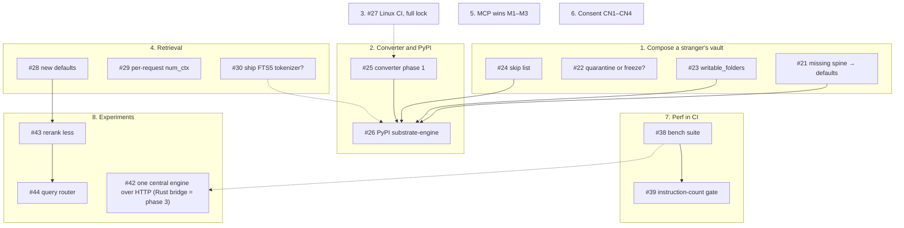

# Roadmap

substrate is a local knowledge engine for Markdown vaults. It composes a project vault and the
vaults it inherits into a named **scope**, indexes it, and answers search over it from the command
line or through an MCP server. It runs on your machine and talks only to a model server on loopback
(Ollama today).

**The next goal is `pip install substrate-engine` working on anyone's vault, on macOS and Linux.**
Today the engine ships inside the Scripta app on Apple silicon, and an ordinary Obsidian vault
can't compose until it adopts this engine's frontmatter and folder conventions. The themes below
are in the order we expect to take them. Measured retrieval changes, performance in CI and a few
experiments run alongside.

**Want to pick one up?** Comment on its issue first, so two people don't build the same thing, and
read [`CONTRIBUTING.md`](CONTRIBUTING.md). Items labelled **`needs-decision`** wait on a
maintainer's choice; the issue says what the choice is. Please don't start one until it is made.
Items labelled **`good first issue`** need no models and no special hardware.

## Words used below

| word | meaning |
|---|---|
| vault | a folder of Markdown notes |
| scope | a project vault plus the vaults it inherits, composed and indexed as one |
| compose | read a scope's vaults and write its index |
| spine | the frontmatter fields retrieval filters and ranks on: `status`, `doc_type`, `confidence` |
| manifest | `.substrate.toml` in a project vault: its name, what it inherits, and its settings |
| `serve` | the long-running engine: answers over a Unix socket and keeps indexes fresh |
| bridge | `substrate-mcp --connect`, a small process that relays one MCP client's stdio to `serve` |
| grant | the user's consent for one named client, stored by `substrate grant`. Writes need one today |
| contract | `contract/contract.json` and `contract/frames/`: what clients may rely on, generated from the code |
| lexprec | a fusion rule: when the keyword top hit is a precise match, keep keyword order first |
| MRR@5 | mean reciprocal rank of the right answer within the top 5. Higher is better |
| quiet machine | a latency run with only the model server busy |

**How the numbers here were measured.** Accuracy comes from a private evaluation set built from
real notes, so it isn't published. Deltas are paired, with 95% confidence intervals clustered by
note, and a change is adopted only if no group of queries gets significantly worse and no negative
case leaks. No latency figure here is a quiet-machine measurement yet. The default stack must fit a
32 GB laptop. A number this page proposes is a target, not a result.

## Order at a glance

Solid arrows are hard dependencies; dotted ones mean "decide or measure first".

---

## 1. Compose a stranger's vault (pip blockers)

These come first: until an ordinary vault composes, a pip package has nothing to offer.

| id | item | status |
|---|---|---|
| [#21](https://github.com/Ronan-Wood/substrate/issues/21) | A note with no `status` or `doc_type` composes with the defaults (`active`, `reference`) instead of refusing the whole scope, and `substrate status` reports how many notes were defaulted. Corrupt input (unparseable frontmatter, duplicate `doc_id`, an unreadable note, a missing declared vault) still refuses. | planned |
| [#22](https://github.com/Ronan-Wood/substrate/issues/22) | Whether one malformed note quarantines itself (the rest of the scope is indexed and the note is reported loudly) or freezes the scope as today. The lean is quarantine, with a hard fail above some fraction of the scope. | `needs-decision` |
| [#23](https://github.com/Ronan-Wood/substrate/issues/23) | The manifest declares `writable_folders` for `ingest`. The default becomes any folder in the project vault that compose doesn't skip, instead of three fixed folder names. Path containment checks stay as they are. | planned |
| [#24](https://github.com/Ronan-Wood/substrate/issues/24) | The manifest declares a `skip` list. Today's hard-coded skips (`_meta.md`, `log.md`, `MEMORY.md`, `99-templates/` and the rest) become defaults a vault can change. | planned |

## 2. Converter carve-out, then PyPI

Document conversion (Office, HTML, scanned PDFs, images) accounts for 954 of the 987 MiB of
packages in Scripta 0.3.5's bundled engine, through docling and torch. The core needs `pypdfium2`, `pyyaml` and
`numpy`, about 26 MiB.

| id | item | status |
|---|---|---|
| [#25](https://github.com/Ronan-Wood/substrate/issues/25) | **Phase 1.** Two extras: `[convert]` (docling-slim's torch-free format readers, the same readers the engine runs today) and `[convert-ml]` (layout and table models, OCR, granite-docling). `numpy` becomes a declared core dependency. `[convert-ml]` always runs in a JSON-lines stdio worker process. CI gains core-only jobs that prove the core runs with nothing else installed. Ten design decisions (D1–D10) are open; the issue lists them with a recommendation each. | `needs-decision` |
| [#26](https://github.com/Ronan-Wood/substrate/issues/26) | **Phase 2.** Publish `substrate-engine` to PyPI (the name `substrate` belongs to another project). The commands keep their names. Needs a build system, `[project.scripts]`, Trusted Publishing from a tag-gated job, and a decision on pure versus per-platform wheels, which [#30](https://github.com/Ronan-Wood/substrate/issues/30) and D4 drive. Documented install: `uv tool install --python 3.14 'substrate-engine[convert]'`. | `needs-decision`, after [#25](https://github.com/Ronan-Wood/substrate/issues/25) and [#21](https://github.com/Ronan-Wood/substrate/issues/21)–[#24](https://github.com/Ronan-Wood/substrate/issues/24) |

Later converter phases, not filed yet: a conversion benchmark and reader bake-off (which also picks
the Linux OCR default, D10), an escalation router between tiers, and Scripta bundling the pinned
extras.

## 3. Linux

| id | item | status |
|---|---|---|
| [#27](https://github.com/Ronan-Wood/substrate/issues/27) | A CI job that installs the full locked environment on Ubuntu (`uv sync --frozen`) and runs the whole suite, with only named macOS-only tests allowed to skip. It needs torch pinned to its CPU build on Linux and OpenCV built from source as on macOS. Today's Linux job installs a handful of packages. | planned |

## 4. Retrieval

| id | item | status |
|---|---|---|
| [#28](https://github.com/Ronan-Wood/substrate/issues/28) | Four rule changes, no new model: lexprec fusion, the Qwen3 query-instruct prefix, graded rerank verdicts (promote at P(yes) ≥ 0.9) and a rerank pool of 30. MRR@5 on the decision set (1,368 positives, 60 negatives): **0.767 shipped → 0.821**, with no HyDE call and no negative leaked. Open question: whether the default drops HyDE. One PR per change, then a latency pass. | `needs-decision` |
| [#29](https://github.com/Ronan-Wood/substrate/issues/29) | Send `num_ctx` with each model request (4096 rerank, 8192 embed). Measured: embedder 4.8 → 1.2 GB resident, reranker 8.7 → 2.9 GB, with identical outputs. | `needs-decision` |
| [#30](https://github.com/Ronan-Wood/substrate/issues/30) | Ship the FTS5 identifier tokenizer (a Rust SQLite extension; the experiment is on branch `exp/fts5-tokenizer`). Respelled identifiers gain MRR@10 +0.201 keyword-only and +0.147 hybrid, with no change on the set as written. Shipping means a schema bump, per-platform builds and signing inside the macOS app, and it makes the wheel per-platform. | `needs-decision` |

## 5. MCP: small wins

Independent, small, and good first issues.

| id | item |
|---|---|
| [#31](https://github.com/Ronan-Wood/substrate/issues/31) | `expand mode=note` pages with `offset` and `max_chars`, so a note longer than 20,000 characters can be read to the end. `documents` already pages the same way. |
| [#32](https://github.com/Ronan-Wood/substrate/issues/32) | An `include_superseded` flag, default false, on `search` and `documents`, so a `supersedes` link can be followed. |
| [#33](https://github.com/Ronan-Wood/substrate/issues/33) | `search` accepts a `doc_type` filter, as `documents` already does. Today it returns an error. |

## 6. Extending consent

Writes already need a per-client grant (`substrate grant`). These extend the same model.

| id | item | status |
|---|---|---|
| [#34](https://github.com/Ronan-Wood/substrate/issues/34) | Per-client read grants: `substrate grant <client> --reads <scopes> [--sources]`. `--sources` lets a trusted client see call transcripts without passing `include_sources` on every call. | planned |
| [#35](https://github.com/Ronan-Wood/substrate/issues/35) | `substrate grant <client> --direct`: a granted client's `ingest` writes in one call. `amend` keeps plan-then-commit, because its token is a compare-and-swap on the note. | planned |
| [#36](https://github.com/Ronan-Wood/substrate/issues/36) | `[blobs] allow_synced = true` lets the blob store live in a folder a sync client uploads, with a warning about eviction. Owner, mode and ACL checks stay. | planned |
| [#37](https://github.com/Ronan-Wood/substrate/issues/37) | Whether search's models (embedder, HyDE, reranker) may run on a cloud model server when the user opts in per feature, as Scripta now allows for its own features. Proxy, redirect and peer-address hardening stays either way. | `needs-decision` |

## 7. Performance in CI

Nothing measures performance in CI today. The goal is every stage measured and nothing quietly
getting slower.

| id | item | status |
|---|---|---|
| [#38](https://github.com/Ronan-Wood/substrate/issues/38) | One benchmark suite, locally and in CI: search per stage, compose (full, no-op, one note edited), cold start, memory, index size and idle CPU, on seeded synthetic corpora at 1×, 10× and 100× the demo vaults. Model stages use a deterministic stub in CI. | planned |
| [#39](https://github.com/Ronan-Wood/substrate/issues/39) | A Cachegrind instruction-count gate on Linux for CPU-bound stages, failing a PR past a set threshold. Then an interleaved wall-clock A/B that reports only, and memory and size gates. | after [#38](https://github.com/Ronan-Wood/substrate/issues/38) |

## 8. Experiments and verified paths

Each experiment states its success criterion before it runs, and reports in
[`EXPERIMENTS.md`](EXPERIMENTS.md) whether it passed or not.

| id | item | depends on | status |
|---|---|---|---|
| [#40](https://github.com/Ronan-Wood/substrate/issues/40) | A TLA+ model of `serve`: readers, granted writes, the refresh loop, outside composers and shutdown. Checks deadlock, torn documents, lost refreshes and clean shutdown, then validates real traces. | — | planned |
| [#41](https://github.com/Ronan-Wood/substrate/issues/41) | A Lean model of the agent snapshot, the path listed as Planned in [`VERIFIED.md`](VERIFIED.md): without `include_sources`, nothing from a call reaches a published snapshot. | — | planned |
| [#42](https://github.com/Ronan-Wood/substrate/issues/42) | **One central engine for every client.** Phase 1: `serve` speaks MCP Streamable HTTP on loopback, with each granted client's existing token as the bearer, so there's no bridge process and writes go through the same grant, plan and confirm. Phase 2: how a client knows it reached the real engine, locally (launch agent, pinned TLS, or a documented gap) and for server mode on another machine (HTTPS). Phase 3: a static Rust `substrate-connect`, only for stdio-only clients and for Docker or remote use. | decision (phase 2) | `needs-decision` |
| [#43](https://github.com/Ronan-Wood/substrate/issues/43) | Rerank less: skip, size or stop the rerank pool, replayed offline. Target ≥ 40% fewer pairs than [#28](https://github.com/Ronan-Wood/substrate/issues/28)'s 11.4 per query, ≤ 0.005 MRR@5 lost. | [#28](https://github.com/Ronan-Wood/substrate/issues/28) | planned |
| [#44](https://github.com/Ronan-Wood/substrate/issues/44) | A model-free query router that skips HyDE on keyword and identifier queries. | [#43](https://github.com/Ronan-Wood/substrate/issues/43) | planned |
| [#45](https://github.com/Ronan-Wood/substrate/issues/45) | A no-op compose rewrites nothing: profiled in November, it re-read and re-wrote every note's intermediate file. Then profile compose at 10× and 100× scale. | — | planned |

Experiment results that live on branches: `exp/fts5-tokenizer` ([#30](https://github.com/Ronan-Wood/substrate/issues/30)), `exp/vector-scale` (brute-force
vector search holds to about 250k–500k passages per scope) and `exp/runtime-profile` (where a search
spends its time).

## 9. Repository hygiene

| id | item | status |
|---|---|---|
| [#47](https://github.com/Ronan-Wood/substrate/issues/47) | A CI gate that fails a PR whose diff or commit messages carry personal data: structural rules that need no list (home-folder paths, cloud-sync folder paths, frames pointing outside the demo fixtures, database files), plus a match against a private list that is never readable in the repo. Local hooks exist; CI has nothing. Scripta gets the same gate. | planned |
| [#48](https://github.com/Ronan-Wood/substrate/issues/48) | Stale sections in `EXPERIMENTS.md`, the "inert inside Scripta" comments in the CI files, and an out-of-date log-probabilities caveat in `rerank_cross.py`. | PR in preparation |

## 10. Needs a decision: multi-machine sync

| id | item | status |
|---|---|---|
| [#46](https://github.com/Ronan-Wood/substrate/issues/46) | Sync vaults between machines without a third-party sync folder. A design exists: each machine keeps its vaults in a local git repository, and `substrate sync` exchanges encrypted git bundles through an object-storage bucket. Indexes never sync; each machine recomposes. It is proposed, not built. Build it or shelve it? Backups should land before sync makes a mistake reach every machine at once. | `needs-decision` |

---

## Later (no issue yet)

Kept from the previous roadmap; each gets an issue when its turn comes.

| area | items |
|---|---|
| Linux and Docker | OCR on Linux through Tesseract (with [#25](https://github.com/Ronan-Wood/substrate/issues/25)'s bake-off); portable model defaults (no `-mlx` tags); the blob store's privacy checks on Linux (ACLs, sync folders by name, `ctime`); `serve` over TCP with a bearer token; a multi-arch container image; a release workflow with attestations and an SBOM; automated engine bumps in Scripta |
| Getting started | `substrate new` to create a vault; a proper `help` command; `substrate doctor`; `substrate mcp setup <client>`; first-run walkthroughs, measured |
| Verified paths | Lean models of the compose prune, scope composition, supersession and the frontmatter YAML emitter; incremental compose proved equal to full compose (unlocks [#45](https://github.com/Ronan-Wood/substrate/issues/45)'s larger speedup) |
| Performance | a per-stage latency budget; model-side passes; hot paths in Rust or C only where [#38](https://github.com/Ronan-Wood/substrate/issues/38) shows a gain; start-up and footprint |
| Retrieval | a Lean and Hypothesis proof of the lexprec rule once [#28](https://github.com/Ronan-Wood/substrate/issues/28) ships; one quiet-machine latency sitting for [#28](https://github.com/Ronan-Wood/substrate/issues/28), [#42](https://github.com/Ronan-Wood/substrate/issues/42)'s phase 3, [#43](https://github.com/Ronan-Wood/substrate/issues/43) and [#44](https://github.com/Ronan-Wood/substrate/issues/44) |
| App side | Scripta attaching to a remote engine over TCP; backups that sync can't overwrite |
| Docs | `docs/experiments/`, one page per experiment, with `EXPERIMENTS.md` as its index |

## Shipped

| what | PR |
|---|---|
| The engine has its own repository, signed release tags and source tarballs | the split, in Scripta's repository |
| A Lean model of `blobs gc --unreferenced`, run against the planner in CI; `VERIFIED.md` | #3 |
| A newcomer can install, run and contribute from the repo alone | #4 |
| A YAML block list no longer drops a note's frontmatter | #5 |
| The embedder refuses a model that runs in Ollama's cloud | #7 |
| Consented writes: `substrate grant`, `revoke`, `grants`, `serve --writes=granted` | #8 |
| Frontmatter ends only at a whole `---` line | #10 |
| MCP `ingest` takes the note as content and never reads a caller's path | #11 |
| **v0.2.0** | #12 |
| The vault guard is removed; agent snapshots leave out calls unless a vault opts in | #13 |
| A write log, `provenance` on passages, and `substrate writes check` | #14 |
| **v0.2.1** | #15 |
| The golden contract frames are one capture again, with a test that keeps them so | #16 |
| **v0.2.2** | #17 |

**Dropped:** the guard correctness fix and the Lean proof of the guard, because the guard itself
was removed in #13.
